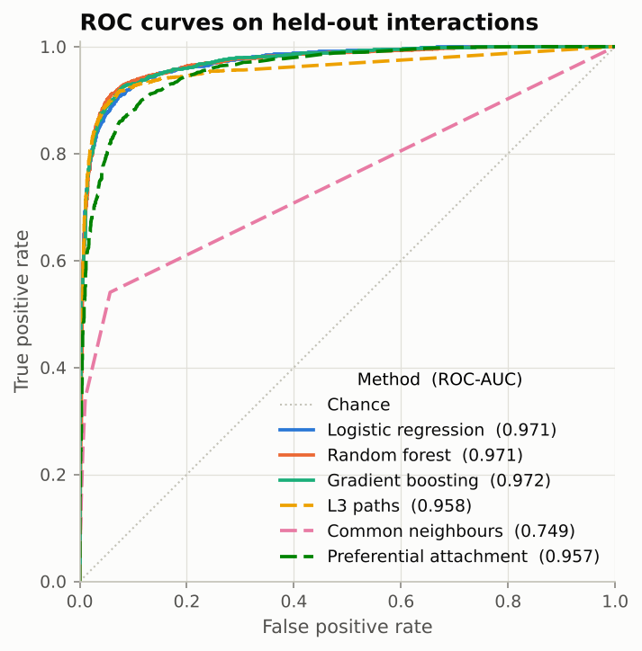
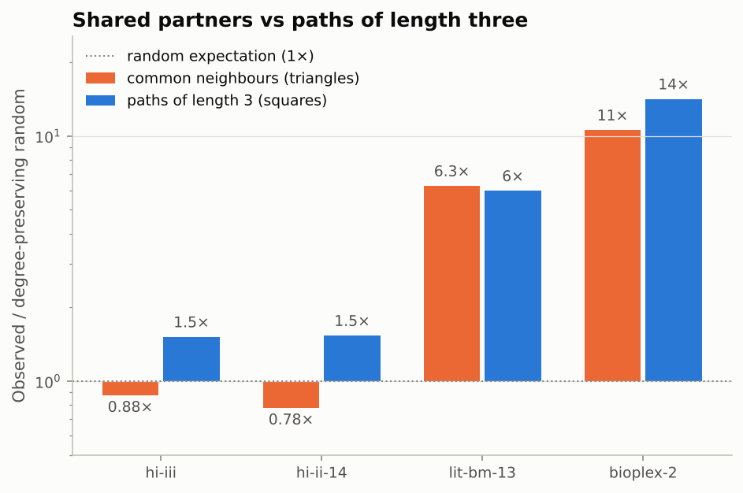
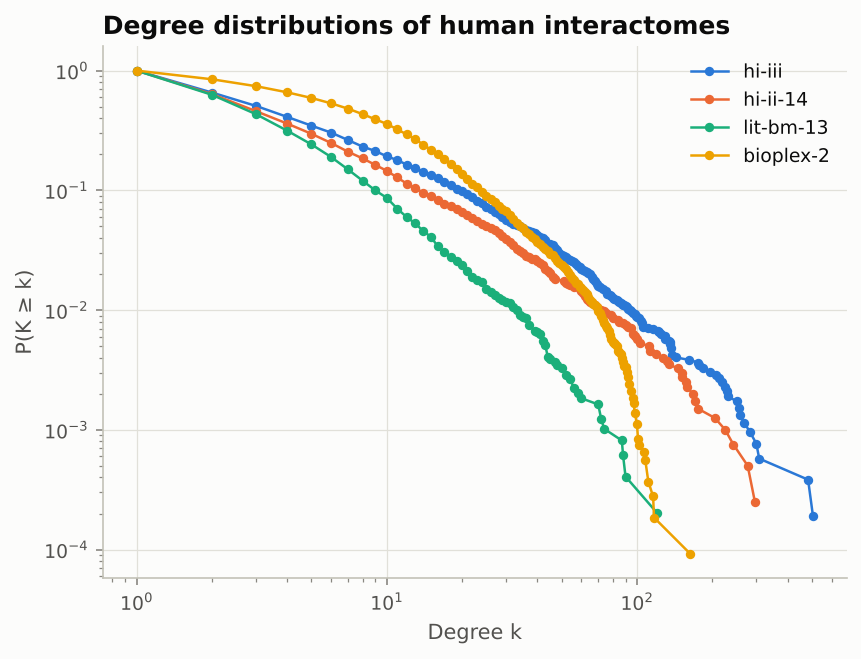
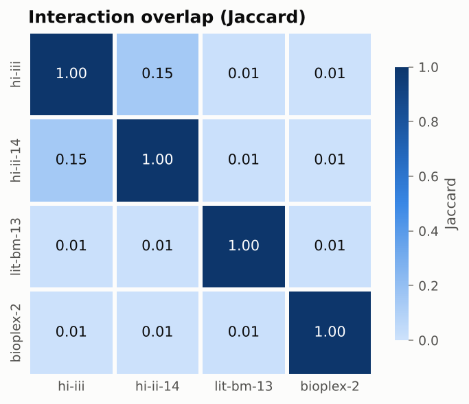
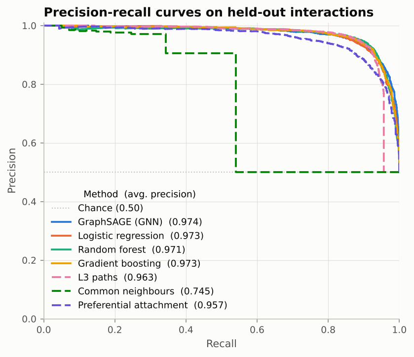
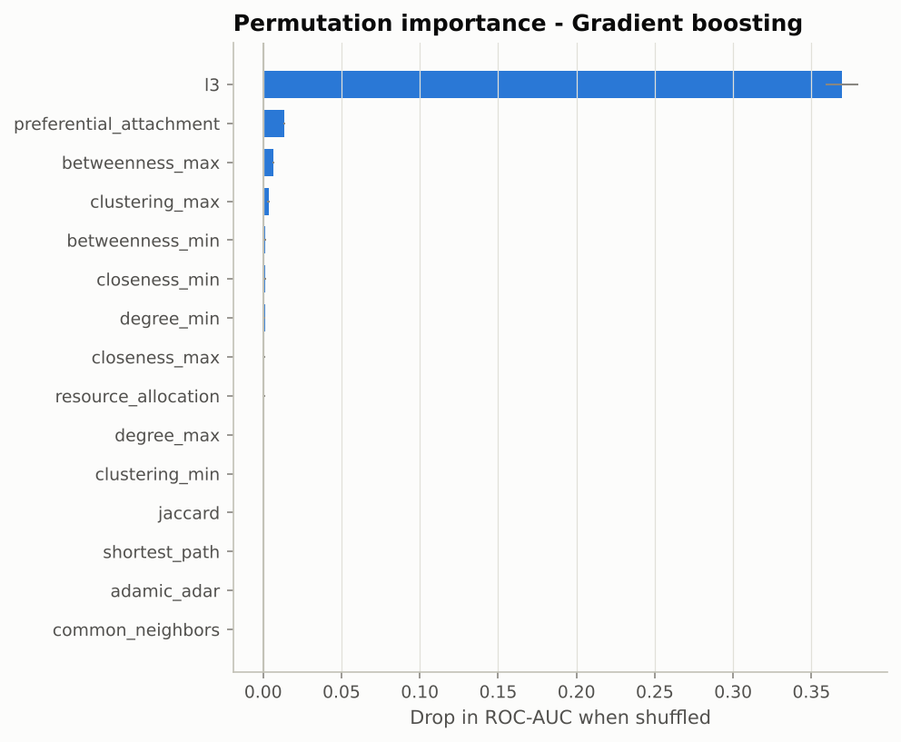
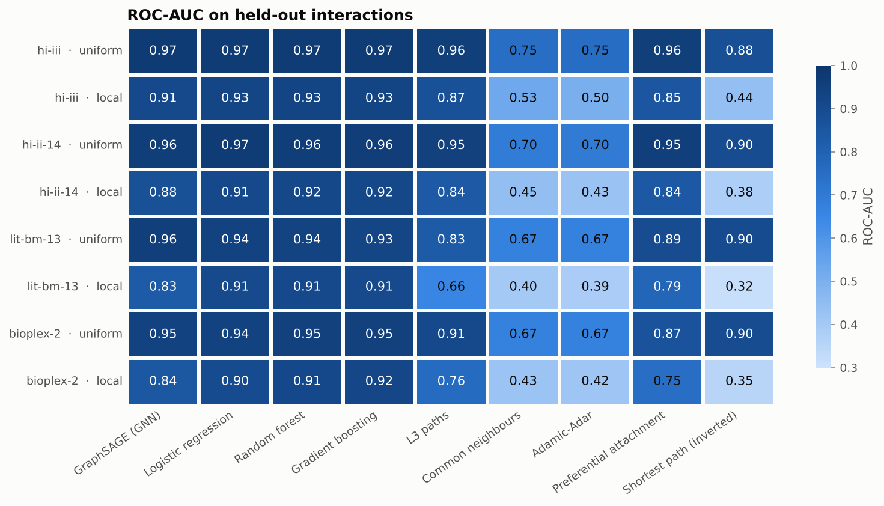
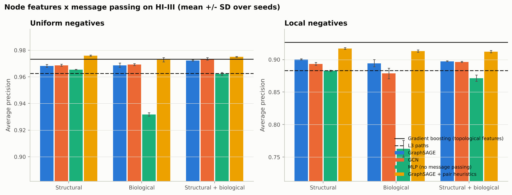
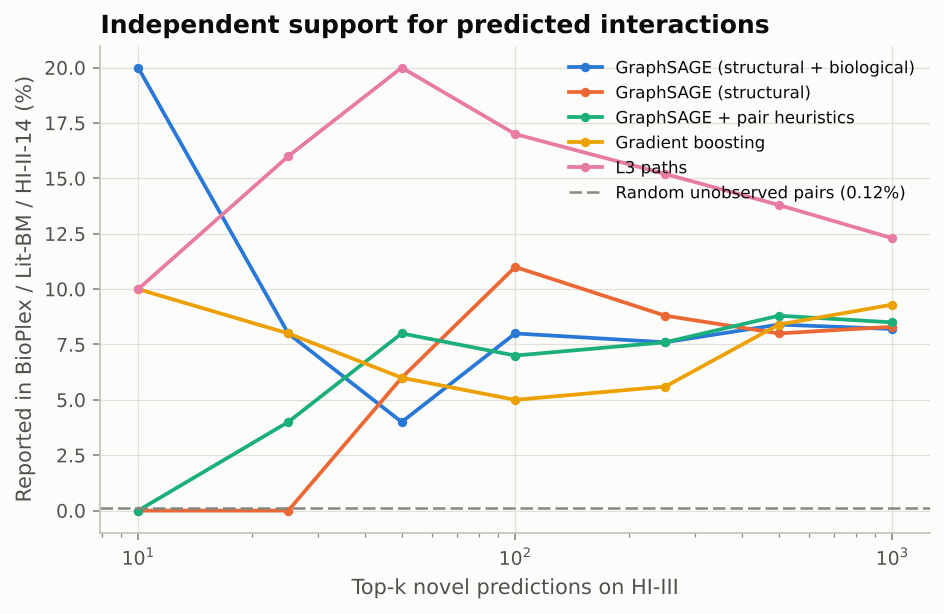
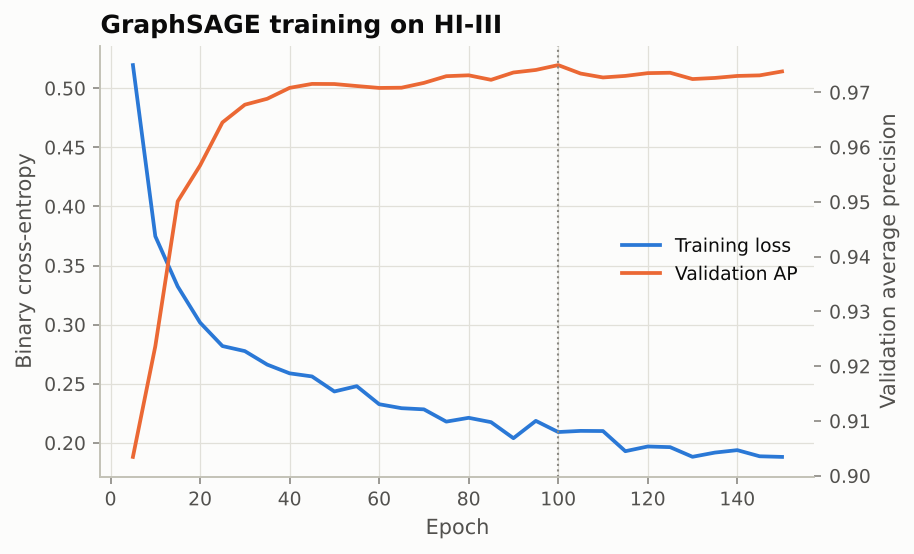

# Graph Neural Networks for Protein-Protein Interaction (PPI) Prediction

[](https://github.com/Raghayev17889/GNN_for_PPI/actions/workflows/ci.yml)


## Overview

This repository contains a modular Python pipeline for modelling and predicting protein-protein
interactions (PPIs). It combines **graph neural networks** (GraphSAGE and GCN in PyTorch Geometric), which
learn protein representations from the interaction network and functional annotation, with a classical
baseline built on structural graph theory and topological network metrics. Together they show how
computational network analysis can uncover hidden functional relationships in molecular biology.

It was built as part of a bioinformatics portfolio and connects graph analytics with biological network
interpretation, following the analytical frameworks used in systems biology research. Everything runs on
**real human interactome data**: four public maps are downloaded, checksum-verified, preprocessed with an
audit trail, analysed and modelled, and the models are interpreted biologically.

**Results in brief**

* On the **HI-III** human interactome (5,216 proteins, 22,195 binary interactions), a two-layer
  **GraphSAGE** GNN predicts held-out interactions with **ROC-AUC 0.974**, on par with gradient boosting on 15
  hand-crafted topological features (0.972). A hybrid GNN that also sees path counts is the best method
  overall (average precision **0.976** vs 0.973).
* **Message passing turns biology into a predictor.** GO, pathway and tissue annotation alone reach AP 0.93.
  Aggregated over interaction partners by two GNN layers they reach 0.97. Against hard negatives
  (non-interacting proteins two or three steps apart, which share annotation with true partners) they stop
  helping, and the classical model stays ahead (ROC-AUC 0.934 vs 0.924 for the best GNN).
* **Biological interpretation.** GNN embeddings recover molecular machines such as the general transcription
  factors, CCR4-NOT and cullin-RING ligases, partly even without annotation. The top novel predictions centre
  on the BCL-2 apoptosis network, with independent literature support for some of them, and are far less
  hub-dominated than topological rankings (36% vs 93% involve a top-1% hub).
* The most informative signal is not shared partners but **paths of length three (L3)**. In systematic
  yeast two-hybrid maps, interacting proteins share *fewer* partners than degree-matched random networks
  (0.78-0.88×) but are linked by *more* length-3 paths (1.5×). This matches the complementarity principle
  of protein binding (Kovács et al., 2019).
* Across four interactomes (binary Y2H, literature-curated, co-complex mass spectrometry), L3 beats
  common neighbours on every map. With hard negatives, common-neighbour scores fall to chance or below.
  The supervised models are the most robust method everywhere (ROC-AUC 0.90-0.97).

<p align="center">
  
  
</p>

## Key features

* **Graph neural networks** (`src/gnn_model.py`). Two-layer **GraphSAGE** and **GCN** encoders in PyTorch
  Geometric, an MLP control without message passing, a symmetric pair decoder, an optional hybrid decoder with
  path heuristics, exhaustive scoring of all 13.6 million unobserved pairs, and self-contained checkpoints.
* **Biological node features** (`src/node_features.py`, `src/annotations.py`). Structural descriptors plus
  GO biological process, GO cellular component, pathways and tissue expression from Hetionet, compressed by
  truncated SVD.
* **GNN experiments** (`src/gnn_experiments.py`). An ablation of 3 encoders plus a hybrid × 3 feature sets ×
  3 seeds × 2 negative protocols, and validation of novel predictions against three independent interactome
  maps.
* **Biological interpretation** (`src/interpretation.py`, notebook 04). Embedding modules with pathway
  enrichment against a permutation null, hubs and bottlenecks (Yu et al., 2007), bridging interactions, and
  hub bias of predictions.

* **Real data acquisition.** A registry of public human interactomes (HI-III, HI-II-14, Lit-BM-13,
  BioPlex 2.0, BioGRID) and an NCBI gene annotation, downloaded from commit-pinned URLs with SHA-256
  verification, retries and atomic writes (`src/datasets.py`).
* **Audited preprocessing.** Parses header-less files with classic-Mac line endings, removes homodimers,
  collapses duplicate and reversed pairs, drops discontinued gene IDs and non-protein-coding loci, keeps
  the largest component, adds gene symbols, and records what every step removed (`src/preprocessing.py`).
* **Exploratory data analysis.** Network statistics, degree distributions, overlap between maps, hubs,
  and a triangle-vs-square closure test against degree-preserving null models (`src/data_analysis.py`).
* **Network construction.** Generic edge lists (TSV/CSV) and STRING `protein.links` files into `NetworkX`
  graphs (`src/graph_builder.py`).
* **Leakage-free evaluation protocol.** Hidden test and training interactions are removed from the graphs
  on which their features are computed, so no pair ever "sees" its own edge. A protected random spanning
  tree keeps every protein connected. Negatives can be sampled **uniformly** or **locally** (2-3 hops apart).
* **Topological features.** 15 symmetric features per protein pair:
  * Node level (min and max over the pair): degree, clustering coefficient, betweenness and closeness
    centrality.
  * Pairwise: common neighbours, Jaccard (neighbourhood overlap), Adamic-Adar, resource allocation,
    preferential attachment, **degree-normalised L3 paths**, and shortest-path distance.
  * Sparse-matrix implementations, compiled closeness, and automatic sampled betweenness above 3,000
    proteins.
* **Machine-learning classification.** Logistic regression (log-scaled features), random forest and
  histogram gradient boosting from `scikit-learn`, with stratified cross-validation.
* **Thorough evaluation.** ROC-AUC, average precision (PR-AUC), R-precision, precision, recall, F1, MCC,
  confusion matrices and permutation importance, benchmarked against unsupervised heuristics and across
  datasets (`src/benchmark.py`).
* **Novel interaction ranking** with gene symbols, plus a check for hub bias.
* **Tested:** 126 `pytest` tests and GitHub Actions CI, which downloads HI-III and trains the classical models
  and two GNNs on every push.

## Data

| dataset | type | proteins | interactions | source |
|---|---|---:|---:|---|
| **HI-III** (default) | binary, yeast two-hybrid | 5,216 | 22,195 | CCSB systematic screen, published as HuRI (Luck et al., 2020) |
| HI-II-14 | binary, yeast two-hybrid | 3,985 | 12,883 | Rolland et al., 2014 |
| Lit-BM-13 | binary, literature-curated | 4,909 | 9,865 | Rolland et al., 2014 |
| BioPlex 2.0 | co-complex, AP-MS | 10,801 | 55,862 | Huttlin et al., 2017 |
| BioGRID | mixed | 15,284 | 183,397 | BioGRID human physical interactions |
| Hetionet v1.0 | annotation | | | GO, pathways, tissue expression for GNN node features (Himmelstein et al., 2017) |

Counts are after preprocessing. Files come from the repository of Kovács et al. (2019) as Entrez gene ID
edge lists, and gene symbols and types from an NCBI Entrez Gene snapshot. See
[`data/README.md`](data/README.md) for provenance and formats. A small **synthetic** network
(`data/raw/sample_ppi_edges.tsv`) is also bundled for offline tests and demos.

### Preprocessing (HI-III)

| step | interactions removed | interactions left | proteins left |
|---|---:|---:|---:|
| raw file | | 23,322 | 5,604 |
| self-interactions (homodimers) | 322 | 23,000 | 5,579 |
| duplicate / reversed pairs | 0 | 23,000 | 5,579 |
| identifiers missing from annotation | 16 | 22,984 | 5,572 |
| non-protein-coding genes | 672 | 22,312 | 5,417 |
| largest connected component | 117 | 22,195 | 5,216 |

The audits for every dataset are in `reports/data_analysis/preprocessing_steps.csv`.

## Data analysis

The full analysis is in
[`notebooks/01_data_preprocessing_and_eda.ipynb`](notebooks/01_data_preprocessing_and_eda.ipynb) and
[`reports/data_analysis/`](reports/data_analysis/).

* All four maps are sparse (density ≈ 0.1%), small-world (mean distance 3.9-5.3 hops), heavy-tailed and
  disassortative. The Y2H maps have the most extreme hubs: in HI-III, CYSRT1 has 505 partners while the
  median protein has 3.
* The maps overlap moderately in proteins (Jaccard 0.22-0.48) but barely in interactions (about 0.01, or
  0.15 for HI-III vs HI-II-14, which come from the same pipeline). Each map samples a small,
  technology-specific part of the interactome.
* **Triangles vs squares.** Compared with degree-preserving randomisations, Y2H maps are *depleted* in
  shared partners (0.78-0.88×) and enriched in length-3 paths (1.5×). Literature-curated and co-complex
  maps are enriched in both (6-14×). Coverage matters too: even in BioPlex only 38% of interactions have
  a common neighbour, while 83% have a length-3 path.

<p align="center">
  
  
</p>

## Results

### HI-III human interactome

Reproduce with `python src/model.py`, which downloads and preprocesses HI-III on first use. The test set has
2,220 held-out interactions plus 2,220 negatives. Outputs are in [`reports/hi-iii/`](reports/hi-iii/) and
the walkthrough is in
[`notebooks/02_feature_and_model_analysis.ipynb`](notebooks/02_feature_and_model_analysis.ipynb).

| Method | Type | ROC-AUC (uniform neg.) | Avg. precision (uniform) | ROC-AUC (local neg.) | Avg. precision (local) |
|---|---|---:|---:|---:|---:|
| GraphSAGE + pair heuristics | GNN (hybrid) | **0.974** | **0.975** | 0.917 | 0.912 |
| GraphSAGE | GNN | **0.974** | 0.974 | 0.908 | 0.904 |
| Gradient boosting | model | 0.972 | 0.973 | **0.934** | **0.927** |
| Logistic regression | model | 0.971 | 0.973 | 0.925 | 0.916 |
| Random forest | model | 0.971 | 0.971 | 0.932 | 0.925 |
| L3 paths | heuristic | 0.958 | 0.962 | 0.872 | 0.883 |
| Preferential attachment | heuristic | 0.957 | 0.957 | 0.852 | 0.840 |
| Shortest path | heuristic | 0.882 | 0.826 | 0.441 | 0.472 |
| Adamic-Adar | heuristic | 0.751 | 0.755 | 0.503 | 0.581 |
| Common neighbours | heuristic | 0.749 | 0.745 | 0.527 | 0.594 |
| Jaccard | heuristic | 0.735 | 0.682 | 0.364 | 0.404 |

The GraphSAGE rows come from `python src/model.py` (GraphSAGE is trained by default) and the hybrid from
`src/gnn_experiments.py` (mean of three seeds). Five-fold cross-validated ROC-AUC on the training pairs is
0.969-0.970 for all three classical models. Permutation
importance of the best model is dominated by L3: shuffling it costs 0.37 ROC-AUC, more than 25 times any
other feature.

<p align="center">
  
  
</p>

**Candidate novel interactions.** `reports/hi-iii/novel_predictions.csv` lists the 100 unobserved pairs the
best classical model ranks highest (e.g. KRTAP10-8–KANK2, KRTAP10-3–LCE2A). Almost all of them involve one of
the top-1% hubs, mainly keratin-associated proteins with hundreds of Y2H partners. GraphSAGE's list
(`novel_predictions_graphsage.csv`) is led instead by BCL-2 family pairs (BAK1–BIK, BCL2L10–BAK1, MCL1–BIK)
and is discussed in notebook 04.

### Benchmark across interactomes

`python src/benchmark.py` runs the full pipeline on four maps with both negative-sampling protocols
([`reports/benchmark/`](reports/benchmark/)).

<p align="center">
  
</p>

* L3 beats common neighbours on every map, including co-complex BioPlex (0.91 vs 0.67).
* With hard negatives, common-neighbour, Jaccard and shortest-path scores fall to chance or below on every
  map. Nearby non-interacting proteins share partners and are as close as true interactors.
* Lit-BM-13 is the exception for L3: on the literature-curated map, preferential attachment is the stronger
  single signal (0.90 vs 0.83 with uniform negatives, 0.79 vs 0.66 with local ones). The trained models
  still reach 0.94.
* The supervised models are the best methods in every setting, and their advantage grows with hard negatives
  (+0.06 to +0.26 ROC-AUC over L3).
* **GraphSAGE** is the best or joint-best method with uniform negatives on HI-III (0.974) and Lit-BM-13 (0.956
  vs 0.941), where annotation adds most because literature-curated interactions follow known biology. With
  hard negatives it trails the tree models by 0.03-0.08 ROC-AUC on every map: pair-level path counts matter
  more there than learned node embeddings (see the hybrid model below).

## Graph neural networks

`src/gnn_model.py` adds a **graph neural network** that learns protein representations directly from the
interactome, next to the classical feature-engineering pipeline. Both are trained on the same leakage-free
split and scored on the same 4,440 held-out pairs, so the comparison is exact.

```
node features ──► [ 2-layer GraphSAGE / GCN encoder ] ──► protein embedding h (64-d) ─┐
 structural (4)        message passing over the        ┌────────────────────────────┘
 + biological (132)    interaction network             ▼
                                              pair decoder  MLP([h_u ⊙ h_v , |h_u − h_v|  (+ L3, CN, RA)])
                                                                      │
                                                              P(u and v interact)
```

* **Encoder.** Two message-passing layers (PyTorch Geometric), so each embedding summarises a protein's
  partners and its partners' partners, the two-step neighbourhood in which the L3 signal lives.
  * **GraphSAGE** (Hamilton et al., 2017): `h_v' = W1·h_v + W2·mean(h_u : u ∈ N(v))`. The separate
    self-term keeps a protein's own identity from being averaged away by hundreds of hub partners.
  * **GCN** (Kipf & Welling, 2017): symmetric degree-normalised averaging over the protein and its
    partners.
  * **MLP control**: the same two layers *without* message passing, to measure what the network adds.
* **Node features** (`src/node_features.py`).
  * *Structural* (4): log degree, clustering, mean partner degree, two-hop reach. They are recomputed on
    whichever graph messages pass over, so a hidden interaction never shows up in its proteins' degree.
  * *Biological* (132): GO biological process, GO cellular component, pathway membership (Reactome,
    WikiPathways, PID) and tissue expression from Hetionet, each compressed by truncated SVD to 32
    components, plus coverage flags. GO *molecular function* is excluded because "protein binding" is
    itself annotated from interaction assays.
* **Decoder.** A symmetric MLP on `[h_u ⊙ h_v, |h_u − h_v|]`. A dot product would only reward *similar*
  proteins (triadic closure), whereas binding partners are often complementary.
* **Hybrid option** (`--gnn-pair-heuristics`). The decoder also receives three pair-level path counts (L3,
  common neighbours, resource allocation). A node-wise GNN cannot count the paths between two specific
  proteins (Zhang et al., 2021), and those paths are what separates true interactions from nearby
  non-interacting proteins.
* **Training without leakage.** Messages pass over `train_graph` during training and over `test_graph` at
  evaluation. Each epoch hides a random 20% of the message edges and uses them as extra positives.
  Negatives are re-sampled every epoch (uniform, or half "local" hard negatives) and never include a known
  interaction. Early stopping uses average precision on 20% of the training pairs. Test pairs are never
  seen.

### GNN results on HI-III

`python src/gnn_experiments.py` trains every encoder × feature set with three seeds under both negative
protocols (72 models) and writes [`reports/gnn/`](reports/gnn/). Mean over seeds:

| Model | Node features | AP, uniform neg. | AP, local neg. | ROC-AUC, uniform | ROC-AUC, local |
|---|---|---:|---:|---:|---:|
| GraphSAGE + pair heuristics | structural | **0.976** ± 0.001 | 0.917 ± 0.001 | 0.975 | 0.924 |
| GraphSAGE + pair heuristics | biological | 0.973 ± 0.002 | 0.913 ± 0.002 | 0.972 | 0.917 |
| GraphSAGE + pair heuristics | structural + biological | 0.975 ± 0.000 | 0.912 ± 0.002 | 0.974 | 0.917 |
| GraphSAGE | structural | 0.968 ± 0.001 | 0.900 ± 0.001 | 0.969 | 0.908 |
| GraphSAGE | biological | 0.969 ± 0.002 | 0.894 ± 0.005 | 0.970 | 0.902 |
| GraphSAGE | structural + biological | 0.972 ± 0.000 | 0.897 ± 0.001 | 0.972 | 0.902 |
| GCN | structural | 0.969 ± 0.001 | 0.893 ± 0.002 | 0.969 | 0.899 |
| GCN | biological | 0.969 ± 0.001 | 0.879 ± 0.008 | 0.969 | 0.879 |
| GCN | structural + biological | 0.973 ± 0.001 | 0.896 ± 0.001 | 0.973 | 0.894 |
| MLP (no message passing) | structural | 0.965 ± 0.000 | 0.883 ± 0.001 | 0.965 | 0.888 |
| MLP (no message passing) | biological | 0.932 ± 0.001 | 0.763 ± 0.013 | 0.930 | 0.787 |
| MLP (no message passing) | structural + biological | 0.962 ± 0.001 | 0.871 ± 0.005 | 0.963 | 0.877 |
| Gradient boosting (15 topological features) | – | 0.973 | **0.927** | 0.972 | 0.934 |
| L3 paths | – | 0.963 | 0.883 | 0.958 | 0.872 |

<p align="center">
  
</p>

* **Message passing is what makes annotation useful.** On biological features alone, the MLP reaches AP
  0.932; two GraphSAGE or GCN layers lift the same features to 0.969. What a protein does says little about
  whether two given proteins bind, but what its *partners* do says a lot: guilt by association, learned end to
  end.
* **Annotation helps against random pairs, not against neighbours.** With uniform negatives, structural plus
  biological features give the best plain GNN (GCN 0.973). With local negatives they add nothing, because
  proteins two or three steps apart usually sit in the same module and share GO terms and pathways with the
  true partners.
* **Pair-level paths still matter.** Against hard negatives the plain GNNs (AP 0.88-0.90) trail gradient
  boosting (0.927): a node-wise encoder cannot count the length-3 paths *between* two proteins, and that count
  reflects complementary binding interfaces (Kovács et al., 2019). Feeding the decoder L3, common-neighbour and
  resource-allocation scores (hybrid) recovers most of the gap (0.917) and gives the best uniform-negative
  model (0.976).
* Seed-to-seed standard deviations are about 0.001 AP, far below these differences.

**Independent support for novel predictions.** The top-ranked *unobserved* HI-III pairs were looked up in
three other maps of the human interactome: BioPlex 2.0 (AP-MS), Lit-BM-13 (literature) and HI-II-14
(an earlier Y2H screen).

* About **8% of every model's top-1,000 predictions** (12% for L3) appear in at least one independent map,
  against **0.12%** for random unobserved pairs: a 70-100-fold enrichment.
* L3 has the highest support, but every one of its top-100 predictions involves a top-1% hub, and its support
  comes from HI-II-14, an earlier screen with the same assay and the same sticky hubs. Only **36%** of
  GraphSAGE's top-100 predictions involve such a hub (structure-only GraphSAGE: 7%), against 93% for gradient
  boosting.
* GraphSAGE's earliest support comes from the literature-curated Lit-BM-13: two of its top ten predictions,
  **MCL1–BIK** and **MCL1–BCL2L1**, are published interactions missing from HI-III.

<p align="center">
  
  
</p>

### Biological interpretation

[`notebooks/04_gnn_biological_interpretation.ipynb`](notebooks/04_gnn_biological_interpretation.ipynb)
loads the trained GraphSAGE checkpoint (`reports/gnn/model/graphsage_hi-iii.pt`), extracts the protein
embeddings and asks what they mean biologically.

* **Functional modules.** 72% of 25 embedding clusters are enriched for a pathway (3% for shuffled clusters).
  They are molecular machines: the general transcription factors TFIIA/B/E/H (22-fold, FDR 4e-21), CCR4-NOT
  mRNA decay, cullin-RING ubiquitin ligases, the pre-replicative complex, translation initiation factors. A
  structure-only GNN that never sees annotation still forms several-fold more enriched clusters than chance.
* **Partners are complementary, not similar.** 88% of HI-III interactions join two *different* embedding
  clusters. The GNN learns which kinds of proteins bind which, so the decoder uses element-wise products and
  differences rather than similarity.
* **Hubs and bottlenecks.** The main bottlenecks (MEOX2, CYSRT1, LNX1, PROP1, PICK1, UBQLN2) are scaffolds,
  adaptors and promiscuous Y2H proteins, which the GNN places in one functionally unenriched cluster.
  Bridging interactions include CDC37–FATE1 (the HSP90 kinase co-chaperone). Predicted interaction propensity
  correlates with degree (Spearman 0.81), the source of hub bias in link prediction.
* **Novel predictions.** The top of the ranking is the **BCL-2 apoptosis network** (BAK1–BIK, BAK1–BCL2,
  MCL1–BIK, BCL2L10–BAK1) and the **TFIID/TFIIA pre-initiation machinery**. It also contains pairs of
  anti-apoptotic paralogs (MCL1–BCL2A1) that share partners without binding each other, a known failure mode
  of similarity-driven predictors.

## Methodology

```
datasets ──► preprocessing ──► graph_builder ──► leakage-free split ─┬─► feature_extractor ──► model ──────► evaluate
 download     audited cleaning   NetworkX graph   train/test graphs   │    15 features/pair     3 classifiers   metrics,
 + verify     + gene symbols                      + negatives         │                                         plots, ranking
                                                                      └─► node_features ──► gnn_model ─────┘
 annotations (Hetionet: GO, pathways, tissues) ─────────────────────────► structural +       GraphSAGE / GCN
                                                                          biological          (PyTorch Geometric)
 data_analysis (statistics, overlaps, closure)    benchmark (4 maps × 2 protocols)    gnn_experiments ──► interpretation
```

1. **Split.** Hide 10% of interactions as test positives (`test_graph = G - test`). Then hide another
   10% as training positives (`train_graph = test_graph - train`). Sample the same number of
   non-interacting pairs for each split; train and test negatives are disjoint.
2. **Featurise.** Training pairs are featurised on `train_graph` and test pairs on `test_graph`. This
   simulates predicting interactions that have not been observed yet, and avoids the common leakage in
   which a pair's own edge inflates its common-neighbour or degree features.
3. **Train.** Fit each classifier with 5-fold stratified cross-validation on the training pairs.
4. **Evaluate.** Score test pairs with every model and every heuristic, plot ROC/PR curves, and compute
   permutation importance for the best model.
5. **Predict.** Featurise the top-L3 unobserved pairs on the full network and rank them with the best model.
   The GNN instead embeds every protein once and scores all unobserved pairs.
6. **GNN.** Train on the same split: messages pass over `train_graph` (with a random 20% of its edges hidden
   each epoch as extra positives) and over `test_graph` at evaluation (see
   [Graph neural networks](#graph-neural-networks)).

**L3 score** (degree-normalised paths of length three):

$$\mathrm{L3}(u,v)=\sum_{a,b}\frac{A_{ua}\,A_{ab}\,A_{bv}}{\sqrt{k_a\,k_b}}$$

It is computed for many pairs at once as rows of $A D^{-1/2} A D^{-1/2} A$ with sparse matrices.

**Closure test.** For each interaction, the number of shared partners and of simple length-3 paths
($W^3_{uv} - k_u - k_v + 1$) are compared with the same quantities in degree-preserving randomisations
(double edge swaps; Maslov & Sneppen, 2002).

## Project structure

```
├── data/
│   ├── external/                    # downloaded raw interactomes (git-ignored)
│   ├── processed/                   # cleaned edge lists + audit reports (git-ignored)
│   ├── raw/sample_ppi_edges.tsv     # bundled synthetic network
│   ├── generate_synthetic_ppi.py    # duplication-divergence generator
│   └── README.md                    # provenance, formats, preprocessing
├── notebooks/
│   ├── 01_data_preprocessing_and_eda.ipynb   # real data: cleaning audit, statistics, overlaps, closure
│   ├── 02_feature_and_model_analysis.ipynb   # HI-III: features, models, hard negatives, novel predictions
│   ├── 03_synthetic_network_exploration.ipynb  # appendix: the synthetic sample
│   └── 04_gnn_biological_interpretation.ipynb  # GNN embeddings, modules, hubs, novel predictions
├── reports/
│   ├── data_analysis/               # tables and figures from src/data_analysis.py
│   ├── hi-iii/                      # reference pipeline run on HI-III (classical models + GraphSAGE)
│   ├── gnn/                         # GNN ablation, external validation, model/graphsage_hi-iii.pt
│   ├── benchmark/                   # cross-dataset benchmark
│   └── synthetic_sample/            # pipeline on the synthetic network
├── src/
│   ├── datasets.py                  # dataset registry, checksum-verified downloads
│   ├── preprocessing.py             # audited cleaning + gene annotation
│   ├── data_analysis.py             # network statistics, overlaps, closure tests, plots
│   ├── graph_builder.py             # loading, graph construction, leakage-free splits
│   ├── feature_extractor.py         # topological node and pair features
│   ├── annotations.py               # Hetionet GO / pathway / tissue annotation, enrichment tests
│   ├── node_features.py             # structural + biological node features for GNNs
│   ├── gnn_model.py                 # GraphSAGE / GCN link predictor (PyTorch Geometric)
│   ├── gnn_experiments.py           # GNN ablation, reference model, external validation (CLI)
│   ├── interpretation.py            # embedding modules, hubs/bottlenecks, propensity
│   ├── model.py                     # classifiers, GNN training and the end-to-end pipeline (CLI)
│   ├── evaluate.py                  # metrics, plots, evaluation CLI
│   └── benchmark.py                 # pipeline across datasets and protocols
├── tests/                           # pytest suite
├── .github/workflows/ci.yml         # tests + synthetic and HI-III pipeline runs
├── requirements.txt
├── requirements-dev.txt             # + pytest, JupyterLab
└── README.md
```

## Installation and setup

1. Clone the repository:

   ```bash
   git clone https://github.com/Raghayev17889/GNN_for_PPI.git
   cd GNN_for_PPI
   ```

2. Create a virtual environment and install dependencies (Python 3.10+):

   ```bash
   python -m venv venv
   source venv/bin/activate        # On Windows use: venv\Scripts\activate
   pip install torch --index-url https://download.pytorch.org/whl/cpu   # optional: CPU-only PyTorch
   pip install -r requirements.txt
   # for tests and notebooks:
   pip install -r requirements-dev.txt
   ```

Downloads need internet access to `raw.githubusercontent.com` and `media.githubusercontent.com` (about
8 MB for the interactomes and 15 MB for Hetionet). A GPU is not needed: every GNN here trains on a laptop
CPU in a few minutes.

## Usage

### 1. Get and preprocess the data

```bash
python src/datasets.py list                     # available datasets
python src/datasets.py download --all           # data/external/, checksum-verified
python src/preprocessing.py --all               # data/processed/<name>.tsv + <name>.report.json
```

Both steps are optional: the pipeline downloads and preprocesses its dataset on first use.

### 2. Analyse the networks

```bash
python src/data_analysis.py                     # writes reports/data_analysis/
```

### 3. Run the pipeline

```bash
python src/model.py                                     # HI-III, writes to results/
python src/model.py --negatives local                   # harder negative pairs
python src/model.py --dataset bioplex-2                 # another registry interactome
python src/model.py --input data/raw/sample_ppi_edges.tsv   # bundled synthetic network
```

| option | default | description |
|---|---|---|
| `--dataset` | `hi-iii` | registry interactome (`hi-iii`, `hi-ii-14`, `lit-bm-13`, `bioplex-2`, `biogrid`) |
| `--input` | – | any edge list (TSV/CSV) or STRING file instead of `--dataset` |
| `--min-score` | none | drop interactions below this confidence |
| `--source-col`, `--target-col`, `--weight-col` | auto | column names for custom tables |
| `--test-fraction`, `--train-fraction` | 0.1, 0.1 | fractions of interactions hidden |
| `--negatives` | `uniform` | `uniform` or `local` negative sampling |
| `--negative-ratio` | 1.0 | negatives per positive |
| `--models` | all three | subset of `logistic_regression random_forest gradient_boosting` |
| `--cv-folds` | 5 | cross-validation folds (0 disables) |
| `--gnn` | `graphsage` | GNNs to train (`graphsage`, `gcn`, `mlp`); `--gnn` with no names skips them |
| `--gnn-features` | `auto` | `structural`, `biological` or `both` (`auto`: both for registry datasets) |
| `--gnn-pair-heuristics` | off | hybrid decoder that also sees L3, common-neighbour and resource-allocation scores |
| `--gnn-epochs` | 300 | maximum training epochs (early stopping on validation AP) |
| `--betweenness-samples` | `auto` | `exact`, a sample size, or `auto` (exact up to 3,000 proteins, else 1,000 samples) |
| `--top-novel` | 100 | number of novel interactions to rank (0 skips) |
| `--output-dir` | `results/` | where artifacts are written |
| `--seed` | 42 | controls every random step |

Outputs: `metrics.csv`, `predictions.csv`, `feature_importance.csv`, `novel_predictions.csv` and
`novel_predictions_<gnn>.csv` (with gene symbols), `gnn_training_<gnn>.csv`, `run_summary.json`,
`figures/*.png`, `models/*.joblib` and `models/<gnn>.pt`. To re-plot or re-score saved
predictions, run `python src/evaluate.py --predictions results/predictions.csv`.

### 4. Benchmark across datasets

```bash
python src/benchmark.py                          # 4 interactomes × 2 protocols, about an hour on CPU
```

### 5. GNN experiments

```bash
python src/gnn_experiments.py                    # 72 GNNs on HI-III -> reports/gnn/ (about 45 min on CPU)
python src/gnn_experiments.py --seeds 1 --epochs 100 --output-dir results/gnn-quick
```

Each trained model is cached in `results/gnn_experiment_cache/`, so an interrupted run resumes.

### 6. Explore the notebooks

```bash
jupyter lab notebooks/
```

### 7. Use as a library

```python
from src.graph_builder import load_graph, make_link_prediction_split
from src.feature_extractor import TopologicalFeatureExtractor
from src.model import train_models
from src.preprocessing import processed_path

G = load_graph(processed_path("hi-iii"))           # downloads + preprocesses on first use
split = make_link_prediction_split(G, negative_strategy="local", seed=0)
extractor = TopologicalFeatureExtractor(betweenness_samples=1000)
X_train = extractor.fit_transform(split.train_graph, split.train_pairs)
X_test = TopologicalFeatureExtractor(betweenness_samples=1000).fit_transform(split.test_graph, split.test_pairs)
models = train_models(X_train, split.train_labels)
probabilities = models["gradient_boosting"].predict_proba(X_test)

# Graph neural network on the same split
from src.annotations import load_annotations
from src.gnn_model import GNNConfig, TrainedGNN, train_link_predictor
from src.node_features import NodeFeatures

features = NodeFeatures.from_graph(G, "both", load_annotations())
gnn = train_link_predictor(split, features, GNNConfig(architecture="graphsage"))
gnn_probabilities = gnn.predict_proba(split.test_graph, split.test_pairs)
embeddings = gnn.embed(G)                            # proteins x 64 DataFrame
reference = TrainedGNN.load("reports/gnn/model/graphsage_hi-iii.pt")
```

### 8. Run the tests

```bash
pytest
```

The tests use small in-memory graphs and need no downloads. They include brute-force checks of the
exhaustive GNN ranking and of checkpoint round trips.

## Limitations and next steps

* Held-out edges from the same screen are an easier target than truly new interactions, and every map is
  shaped by its assay (Y2H hubs, literature study bias, complex-level AP-MS). Predictions need
  experimental validation.
* Top-ranked novel candidates favour hubs. Degree-aware calibration or degree-matched negatives would be a
  useful extension.
* The GNN uses annotation but not sequence or structure. Protein language-model embeddings (e.g. ESM-2) as
  node features are a natural next step, as is a subgraph GNN (SEAL-style labelling trick) that learns the
  pair-level path patterns the hybrid currently receives as hand-crafted counts.
* GO and pathway annotation is partly derived from published interactions, so annotation-based features and
  literature-based validation are not fully independent. The structure-only GNN is the circularity-free
  reference.
* Similar embeddings make the GNN predict paralog pairs (e.g. two anti-apoptotic BCL-2 proteins) that share
  partners without binding each other. A further test is to train on one map and evaluate on another.
* The gene annotation is a 2016 NCBI snapshot. A current HGNC or NCBI release would recover a few more
  discontinued identifiers.

## Technical stack

* **Language:** Python 3.10+
* **Graph analysis:** NetworkX, SciPy (sparse matrices, `csgraph`)
* **Graph neural networks:** PyTorch, PyTorch Geometric (`SAGEConv`, `GCNConv`)
* **Machine learning:** scikit-learn, pandas, NumPy
* **Visualisation:** Matplotlib, Seaborn
* **Quality:** pytest, GitHub Actions

## References

* Hamilton, W. L., Ying, R. & Leskovec, J. Inductive representation learning on large graphs (GraphSAGE).
  *NeurIPS* (2017).
* Kipf, T. N. & Welling, M. Semi-supervised classification with graph convolutional networks. *ICLR* (2017).
* Zhang, M., Li, P., Xia, Y., Wang, K. & Jin, L. Labeling trick: a theory of using graph neural networks for
  multi-node representation learning. *NeurIPS* (2021).
* Himmelstein, D. S. *et al.* Systematic integration of biomedical knowledge prioritizes drugs for
  repurposing (Hetionet). *eLife* 6, e26726 (2017).
* Yu, H. *et al.* The importance of bottlenecks in protein networks. *PLoS Comput. Biol.* 3, e59 (2007).

* Kovács, I. A. *et al.* Network-based prediction of protein interactions. *Nature Communications* 10,
  1240 (2019).
* Luck, K. *et al.* A reference map of the human binary protein interactome. *Nature* 580, 402-408 (2020).
* Rolland, T. *et al.* A proteome-scale map of the human interactome network. *Cell* 159, 1212-1226 (2014).
* Huttlin, E. L. *et al.* Architecture of the human interactome defines protein communities and disease
  networks. *Nature* 545, 505-509 (2017).
* Maslov, S. & Sneppen, K. Specificity and stability in topology of protein networks. *Science* 296,
  910-913 (2002).
* Liben-Nowell, D. & Kleinberg, J. The link-prediction problem for social networks. *JASIST* 58,
  1019-1031 (2007).
* Vázquez, A., Flammini, A., Maritan, A. & Vespignani, A. Modeling of protein interaction networks.
  *ComPlexUs* 1, 38-44 (2003).

## License

The code is open source and available under the [MIT License](LICENSE). The interaction datasets
belong to their original authors and are downloaded from their published sources, not redistributed here.
Please cite the original publications when you use them.
