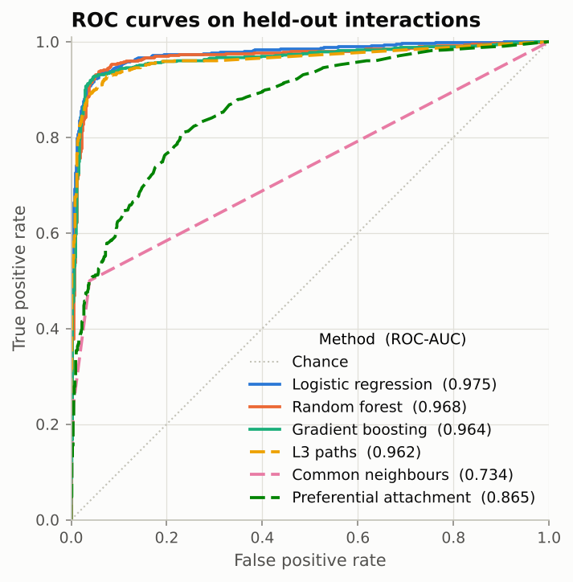
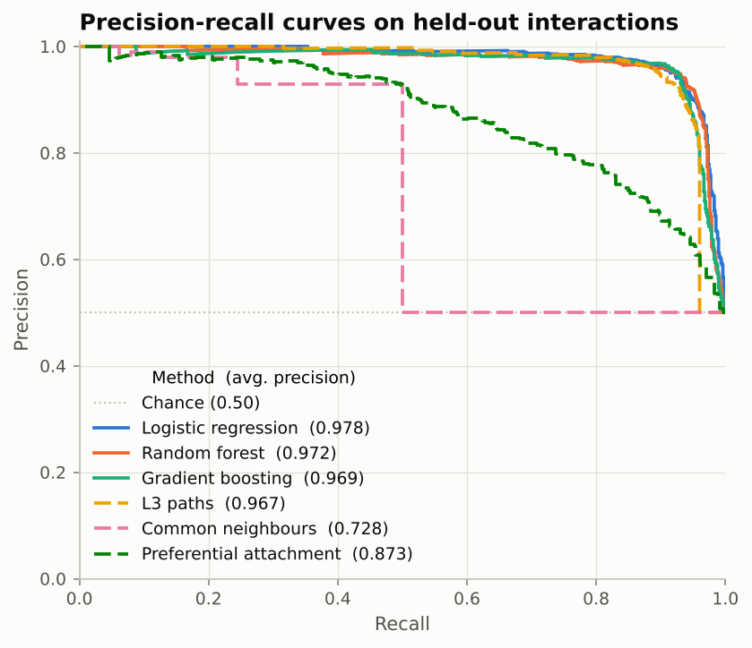
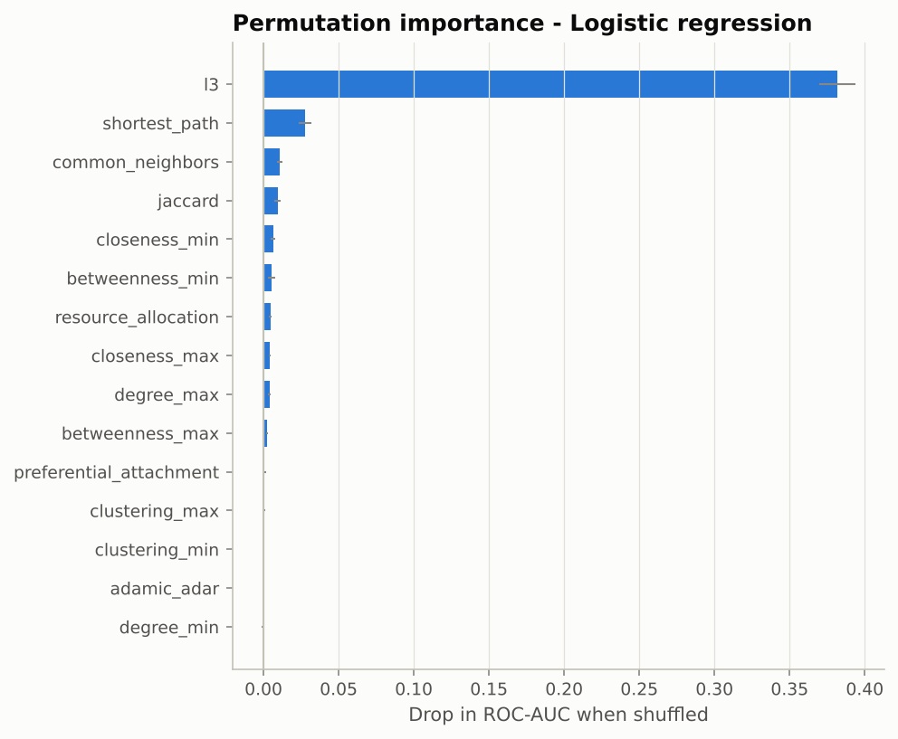
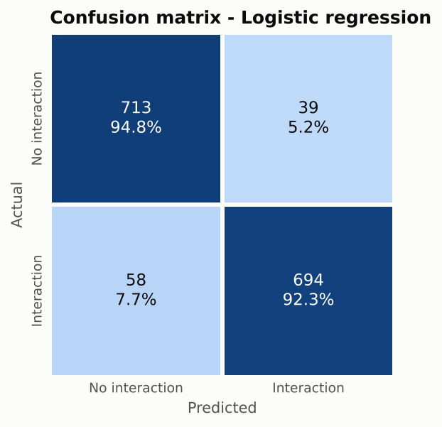

# Graph-Based Protein-Protein Interaction (PPI) Prediction

[](https://github.com/Raghayev17889/GNN_for_PPI/actions/workflows/ci.yml)


## Overview

This repository contains a modular Python pipeline for modelling and predicting protein-protein
interactions (PPIs). By combining structural graph theory, topological network metrics and machine
learning classifiers, it shows how computational network analysis can uncover hidden functional
relationships in molecular biology.

It was built as part of a bioinformatics portfolio and connects graph analytics with biological network
interpretation, following the analytical frameworks used in systems biology research.

**Result in one sentence:** on held-out interactions, topology alone reaches ROC-AUC 0.975, and the most
informative signal is not shared partners but **paths of length three (L3)**. This matches the
complementarity principle of protein binding (Kovács et al., 2019).

<p align="center">
  
  
</p>

## Key features

* **Network construction and representation.** Parses generic edge lists (TSV/CSV) and STRING
  `protein.links` files (gzip supported) into `NetworkX` graphs. It removes self-interactions, collapses
  duplicate pairs, applies optional confidence thresholds and extracts the largest connected component.
* **Leakage-free evaluation protocol.** Hidden test and training interactions are removed from the graphs
  on which their features are computed, so no pair ever "sees" its own edge. A protected random spanning
  tree keeps every protein connected, and negatives can be sampled **uniformly** or **locally**
  (2-3 hops apart; harder and more realistic).
* **Topological feature extraction**, 15 symmetric features per protein pair:
  * Node level (min and max over the pair): degree, clustering coefficient, betweenness and closeness
    centrality.
  * Pairwise: common neighbours, Jaccard (neighbourhood overlap), Adamic-Adar, resource allocation,
    preferential attachment, **degree-normalised L3 paths**, and shortest-path distance.
  * Sparse-matrix implementations, compiled closeness, and optional sampled betweenness for large
    interactomes.
* **Machine-learning classification.** Logistic regression (log-scaled features), random forest and
  histogram gradient boosting from `scikit-learn`, with stratified cross-validation.
* **Thorough evaluation.** ROC-AUC, average precision (PR-AUC), R-precision, precision, recall, F1, MCC,
  confusion matrices and permutation feature importance, benchmarked against unsupervised heuristics.
* **Novel interaction ranking.** Scores currently unobserved protein pairs (pre-selected by L3) and
  outputs the most likely missing interactions.
* **Tested:** 53 `pytest` tests (features checked against NetworkX and brute force, split invariants,
  end-to-end run) with GitHub Actions CI.

## Results

Reference run on the bundled synthetic network (2,000 proteins, 7,518 interactions; 752 held-out test
interactions plus the same number of negatives). Reproduce with `python src/model.py`. Full outputs are in
[`reports/`](reports/), and the analysis is in
[`notebooks/02_feature_and_model_analysis.ipynb`](notebooks/02_feature_and_model_analysis.ipynb).

| Method | Type | ROC-AUC (uniform neg.) | Avg. precision (uniform) | ROC-AUC (local neg.) | Avg. precision (local) |
|---|---|---:|---:|---:|---:|
| Logistic regression | model | **0.975** | **0.978** | 0.897 | 0.887 |
| Random forest | model | 0.968 | 0.972 | 0.897 | 0.882 |
| Gradient boosting | model | 0.964 | 0.969 | **0.901** | **0.890** |
| L3 paths | heuristic | 0.962 | 0.967 | 0.873 | 0.879 |
| Shortest path | heuristic | 0.892 | 0.839 | 0.421 | 0.464 |
| Preferential attachment | heuristic | 0.865 | 0.873 | 0.744 | 0.743 |
| Adamic-Adar | heuristic | 0.737 | 0.741 | 0.448 | 0.494 |
| Common neighbours | heuristic | 0.734 | 0.728 | 0.456 | 0.502 |
| Jaccard | heuristic | 0.729 | 0.705 | 0.352 | 0.407 |

Local negatives: `python src/model.py --negatives local`.

**Findings**

1. **L3 outperforms triadic closure.** Half of the held-out interactions have no common neighbour,
   but 96% are connected by a path of length three. Interacting proteins tend to resemble each other's
   partners (complementary binding interfaces) rather than share partners.
2. **Hard negatives expose weak heuristics.** Against nearby non-interacting pairs, common-neighbour
   scores drop *below chance* because nearby non-interactors, such as paralogs, share many partners.
   L3 and the trained models stay well above chance.
3. **Learning helps where L3 runs out.** The classifiers combine L3 with degree, distance and centrality
   and gain most at high recall, where many pairs have no length-3 path.

<p align="center">
  
  
</p>

> **Note.** The bundled network is **synthetic**. It was generated with the duplication-divergence
> model of PPI evolution so the project runs without downloads. The numbers illustrate the method and are
> not biological findings. Run the pipeline on STRING or BioGRID data for real results (see below).

## Methodology

```
edge list ──► graph_builder ──► leakage-free split ──► feature_extractor ──► model ──► evaluate
 (TSV/STRING)   NetworkX graph    train_graph / test_graph   15 topological      3 classifiers   metrics,
                                  + positives / negatives    features per pair   + CV            plots, ranking
```

1. **Split.** Hide 10% of interactions as test positives (`test_graph = G - test`). Then hide another
   10% as training positives (`train_graph = test_graph - train`). Sample the same number of
   non-interacting pairs for each split; train and test negatives are disjoint.
2. **Featurise.** Training pairs are featurised on `train_graph` and test pairs on `test_graph`. This
   simulates predicting interactions that have not been observed yet, and avoids the common leakage in
   which a pair's own edge inflates its common-neighbour or degree features.
3. **Train.** Fit each classifier with 5-fold stratified cross-validation on the training pairs.
4. **Evaluate.** Score test pairs with every model and every heuristic, plot ROC/PR curves, and compute
   permutation importance for the best model.
5. **Predict.** Featurise the top-L3 unobserved pairs on the full network and rank them with the best
   model (`reports/novel_predictions.csv`).

**L3 score** (degree-normalised paths of length three):

$$\mathrm{L3}(u,v)=\sum_{a,b}\frac{A_{ua}\,A_{ab}\,A_{bv}}{\sqrt{k_a\,k_b}}$$

It is computed for many pairs at once as rows of $A D^{-1/2} A D^{-1/2} A$ with sparse matrices.

## Project structure

```
├── data/
│   ├── raw/sample_ppi_edges.tsv     # bundled synthetic PPI network (scored edge list)
│   ├── generate_synthetic_ppi.py    # duplication-divergence network generator
│   └── README.md                    # data formats, STRING/BioGRID instructions
├── notebooks/
│   ├── 01_network_exploration.ipynb         # degree distribution, clustering, hubs, confidence scores
│   └── 02_feature_and_model_analysis.ipynb  # features, L3 vs triadic closure, models, hard negatives
├── reports/                         # reference run: metrics, figures, novel predictions
├── src/
│   ├── __init__.py
│   ├── graph_builder.py             # loading, graph construction, leakage-free splits
│   ├── feature_extractor.py         # topological node and pair features
│   ├── model.py                     # classifiers and the end-to-end pipeline (CLI)
│   └── evaluate.py                  # metrics, plots, evaluation CLI
├── tests/                           # pytest suite
├── .github/workflows/ci.yml         # tests + pipeline smoke run
├── requirements.txt                 # runtime dependencies
├── requirements-dev.txt             # + pytest, JupyterLab
└── README.md
```

## Installation and setup

1. Clone the repository:

   ```bash
   git clone https://github.com/Raghayev17889/GNN_for_PPI.git
   cd GNN_for_PPI
   ```

2. Create a virtual environment and install dependencies (Python 3.10+):

   ```bash
   python -m venv venv
   source venv/bin/activate        # On Windows use: venv\Scripts\activate
   pip install -r requirements.txt
   # for tests and notebooks:
   pip install -r requirements-dev.txt
   ```

## Usage

### 1. Prepare the data

The bundled sample works out of the box. To use real data, place PPI edge lists in `data/external/`
(see [`data/README.md`](data/README.md)). For example, download a STRING `protein.links` file such as
`4932.protein.links.v12.0.txt.gz` for yeast.

### 2. Run the pipeline

```bash
python src/model.py                                    # bundled sample, writes to results/
python src/model.py --negatives local                  # harder negative pairs
python src/model.py --input data/external/4932.protein.links.v12.0.txt.gz \
    --min-score 700 --betweenness-samples 500          # STRING, high confidence
```

| option | default | description |
|---|---|---|
| `--input` | bundled sample | edge list (TSV/CSV) or STRING file (`.gz` ok) |
| `--min-score` | none | drop interactions below this confidence |
| `--source-col`, `--target-col`, `--weight-col` | auto | column names for custom tables |
| `--test-fraction`, `--train-fraction` | 0.1, 0.1 | fractions of interactions hidden |
| `--negatives` | `uniform` | `uniform` or `local` negative sampling |
| `--negative-ratio` | 1.0 | negatives per positive |
| `--models` | all three | subset of `logistic_regression random_forest gradient_boosting` |
| `--cv-folds` | 5 | cross-validation folds (0 disables) |
| `--betweenness-samples` | exact | approximate betweenness for large networks |
| `--top-novel` | 100 | number of novel interactions to rank (0 skips) |
| `--output-dir` | `results/` | where artifacts are written |
| `--seed` | 42 | controls every random step |

Outputs: `metrics.csv`, `predictions.csv`, `feature_importance.csv`, `novel_predictions.csv`,
`run_summary.json`, `figures/*.png` and `models/*.joblib`.

To re-plot or re-score saved predictions:

```bash
python src/evaluate.py --predictions results/predictions.csv
```

### 3. Explore the notebooks

```bash
jupyter lab notebooks/
```

### 4. Use as a library

```python
from src.graph_builder import load_graph, make_link_prediction_split
from src.feature_extractor import TopologicalFeatureExtractor
from src.model import train_models

G = load_graph("data/raw/sample_ppi_edges.tsv")
split = make_link_prediction_split(G, negative_strategy="local", seed=0)
X_train = TopologicalFeatureExtractor().fit_transform(split.train_graph, split.train_pairs)
X_test = TopologicalFeatureExtractor().fit_transform(split.test_graph, split.test_pairs)
models = train_models(X_train, split.train_labels)
probabilities = models["random_forest"].predict_proba(X_test)
```

### 5. Run the tests

```bash
pytest
```

## Limitations and next steps

* Real interactomes are incomplete and biased towards well-studied proteins. Top-ranked candidates
  favour hubs (see `reports/novel_predictions.csv`), so degree-aware calibration or a degree-matched
  negative set would be a useful extension.
* Topology ignores sequence, structure and expression. Adding sequence embeddings (e.g. ESM) or
  Gene Ontology similarity as pair features is a natural next step, as is a graph neural network (GNN)
  baseline trained with the same leakage-free split.
* Exact betweenness costs `O(nm)`. Use `--betweenness-samples` for networks with tens of thousands of
  proteins.

## Technical stack

* **Language:** Python 3.10+
* **Graph analysis:** NetworkX, SciPy (sparse matrices, `csgraph`)
* **Machine learning:** scikit-learn, pandas, NumPy
* **Visualisation:** Matplotlib, Seaborn
* **Quality:** pytest, GitHub Actions

## References

* Kovács, I. A. *et al.* Network-based prediction of protein interactions. *Nature Communications* 10,
  1240 (2019).
* Vázquez, A., Flammini, A., Maritan, A. & Vespignani, A. Modeling of protein interaction networks.
  *ComPlexUs* 1, 38-44 (2003).
* Liben-Nowell, D. & Kleinberg, J. The link-prediction problem for social networks. *JASIST* 58,
  1019-1031 (2007).
* Szklarczyk, D. *et al.* The STRING database in 2023. *Nucleic Acids Research* 51, D638-D646 (2023).

## License

This project is open source and available under the [MIT License](LICENSE).
